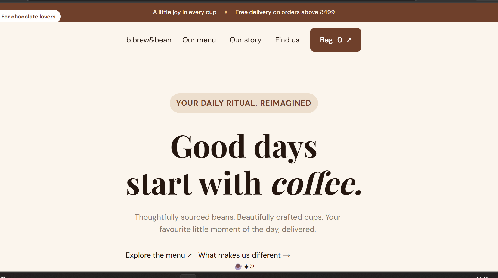
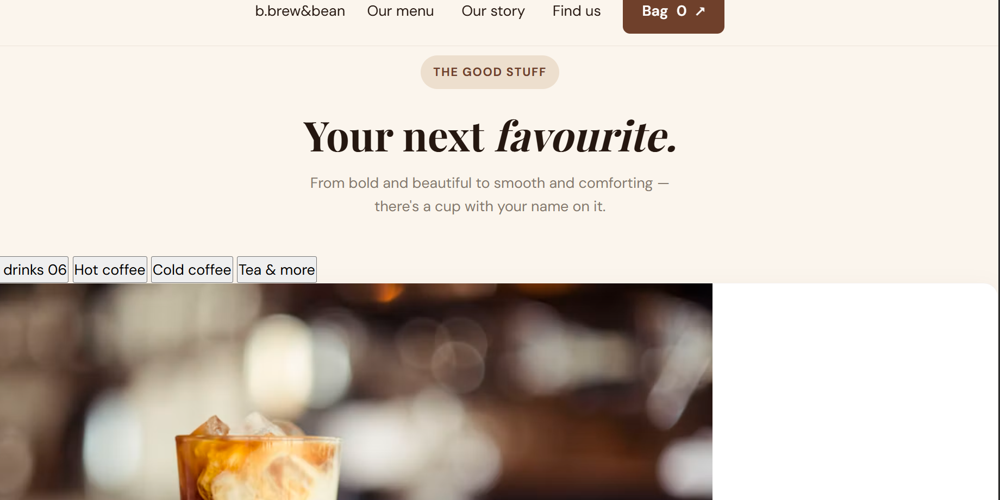

# Brew & Bliss — Coffee Ordering Website

  

  A modern coffee ordering website built with HTML, CSS and JavaScript.
   
  A Good Day Starts with Coffee.

---

## About the Project

Brew & Bliss is a coffee shop frontend project designed with a warm color palette, attractive coffee imagery, and a clean, user-friendly layout. It showcases coffee products and provides a simple browsing experience.

## Features

- Modern coffee shop homepage
- Coffee menu with product images and prices
- Coffee-themed design and typography
- About section
- Responsive layout
- Simple navigation

## Technologies Used

- HTML5
- CSS3
- JavaScript
- Visual Studio Code
- Live Server

## Website Screenshots

### Homepage

### Coffee Menu

## How to Run

1. Clone or download this repository.
2. Open the project folder in VS Code.
3. Open `index.html`.
4. Right-click and select **Open with Live Server**.

## Future Improvements

- Shopping cart functionality
- Coffee search and category filters
- Order summary and checkout
- Personalized coffee recommendations

## Author

**Kajal Behera**

GitHub: [kajalbehera344](https://github.com/kajalbehera344)

---

  Made with coffee and code.

